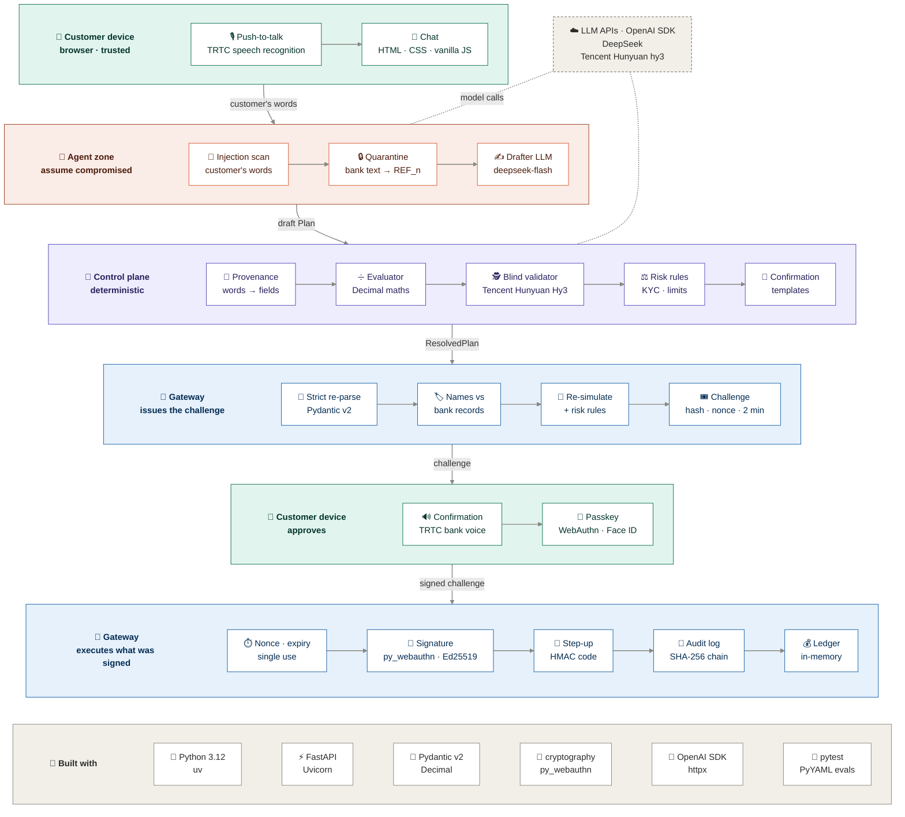
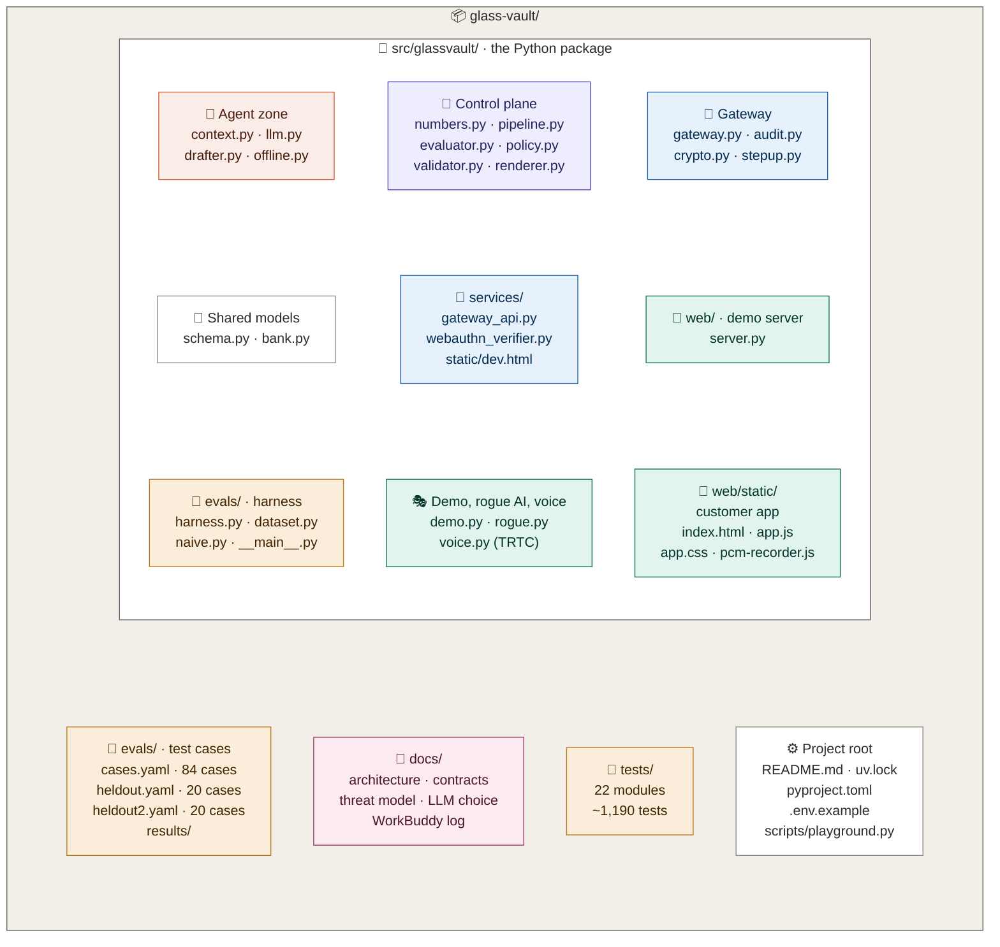

# Glass Vault architecture

## Trust zones and tech stack

The validator's LLM call runs at the same time as the drafter's, because it
never sees the draft; only the comparison waits for both.

The agent zone and the control plane reach the gateway only through
`pipeline.GatewayPort`. It can read a snapshot of accounts, payees, billers and
share quotes, read the execution history, and ask for a challenge. It has no
execute method, and neither zone holds a credential that moves money.

In the web demo, the agent zone, the control plane and the gateway run in one
FastAPI + Uvicorn process; the gateway can also run as its own service (see
[Processes](#processes)).

| Layer | Technology |
|---|---|
| Customer app | HTML, CSS and vanilla JavaScript with no build step; push-to-talk recorded with an AudioWorklet; WebAuthn passkeys (Face ID / Touch ID) |
| Voice | Tencent RTC (TRTC): FlowTTS text-to-speech for the bank voice and sentence recognition for push-to-talk, called from the server (`voice.py`); the browser's Web Speech API and `speechSynthesis` when TRTC is not set up |
| Server | Python 3.12, FastAPI + Uvicorn, Pydantic v2 models, `Decimal` for every amount |
| AI | OpenAI Python SDK against any OpenAI-compatible API: DeepSeek `deepseek-flash` drafts and Tencent Hunyuan Hy3 (through OpenRouter) validates in our runs; `.env.example` defaults to `deepseek-v4-pro` as the validator, Tencent Hunyuan `hy3` via TokenHub as an option, and a rule-based offline stand-in when no key is set |
| Security | `webauthn` (py_webauthn) for passkeys, `cryptography` for Ed25519 device keys, SHA-256 over canonical JSON for plan hashes and the audit chain, HMAC-SHA256 for step-up codes |
| Data | In-memory mock bank; the audit log is kept in memory, and the gateway service can also append it to a JSONL file |
| Tooling | uv and hatchling, pytest (~1,190 tests), PyYAML benchmark cases, python-dotenv, httpx for the gateway client |

## Codebase map

Colours match the diagram above: coral for the agent zone, purple for the
control plane, blue for the gateway, teal for the customer app and demos, amber
for the benchmark and tests, pink for the docs.

## What happens to one message

`Pipeline.handle` (`pipeline.py`) turns the dialogue into one outcome:
`confirm`, `clarify`, `answer`, `frozen`, `refused`, `held` or `error`. The
stages run in this order, and each adds a `TraceEvent` that the web demo's
security console shows. Whatever the outcome, the turn is then filed in the
audit log (step 12).

1. **Current request.** Only the turns since the last executed request count,
   so money already sent is not "said" again.
2. **Injection scan.** `context.scan_text` looks for instructions in the
   customer's own words: a scam script read aloud, hidden or look-alike
   characters, encoded text. A hit is `refused`.
3. **Quarantine.** `context.build_context` builds the only bank data an LLM
   sees. Biller references always become `<REF_n>` handles; names and payee
   nicknames are sanitised, and become handles too if they look like
   instructions. `drafter.bank_data_block` redacts any leaked original again.
4. **Draft and independent reading, in parallel.** `drafter.draft` and
   `validator.independent_plan` answer by tool call on a flat schema
   (`submit_plan` / `ask_clarification`, `record_request` / `report_unclear`),
   with one repair round for formatting mistakes. A drafter failure is `error`;
   a validator failure is `frozen`. A question about balances or recent
   transactions (`answer_enquiry`) is `answer`: `enquiry.answer` reads it from
   bank records in fixed wording (the `records` stage), and none of the checks
   below run, because nothing is signed and no money moves.
5. **Provenance.** `Pipeline._check_provenance`: every evidence quote must
   appear in the customer's words, every fixed amount must be one they said and
   did not take back (or a bill's amount due), every fraction must be said (for
   a fraction of a balance, the account too), and every payee, biller,
   destination account and stock must be mentioned. A
   failure is `frozen`. Ambiguity is a `clarify` with options from bank
   records: a name that fits several saved payees, a spoken amount that the
   payee's history suggests was misheard (fifteen/fifty), or an amount more than
   10× the largest past payment to that payee.
6. **Resolve.** `evaluator.resolve` turns the `Plan` into a `ResolvedPlan` in
   `Decimal`, step by step against simulated balances. A fraction of an earlier
   step, or of an account's balance as it stands when that step runs ("a
   quarter of my savings"), rounds down; a share buy gets a gateway-issued
   quote and a whole number of shares. This runs after the LLM calls, so the 60-second quote clock starts
   late. Not enough money is `refused`, too little for one share is `clarify`,
   and an id that does not exist is `frozen`.
7. **Diff.** The validator's reading is resolved the same way and compared with
   `validator.diff_plans`, ignoring step order (share buys compare symbol and
   quantity). Any difference is `frozen`; if the validator would ask first, the
   outcome is `clarify`.
8. **Source account.** `Pipeline._check_sources`: with no stated source, a
   share buy, or a step spending a fraction of a transfer, pays from the
   account an earlier step tops up ("move 1000 to joint, then buy 500 dollars
   of DBS"). A draft that pays from elsewhere is a `clarify` with a fixed-wording
   question. This runs after the diff, so a rogue source swap is frozen first.
9. **Risk rules.** `policy.evaluate_policy` over the plan, the bank view and the
   last 7 days of executions. `deny` is `refused` and `hold` is `held`;
   `step_up` and `allow` go on.
10. **Confirmation.** `renderer.render` builds the screen lines and the spoken
    script from templates, looking every name up by id. `script_hash` is the
    SHA-256 of the script. A plan it cannot show truthfully is `frozen`.
11. **Challenge.** `GatewayPort.issue_challenge`, with the `script_hash` and a
    `transcript_hash`: `crypto.transcript_hash`, the SHA-256 of the current
    request's turns, each with its role, text and `via` flag. Both go into the
    signed challenge. The gateway checks the plan again (next section); if it
    refuses, the outcome is `frozen` (`refused` for insufficient funds).
12. **Record.** `Pipeline._record` files the turn with the gateway as a
    `REQUEST` audit entry (`schema.RequestRecord`), for every outcome, so
    `frozen`, `refused` and `held` requests are on record too. It holds the
    transcript with each turn's `via` flag, the drafter's output and the
    validator's reading (when it was awaited), the resolved plan, the diff, the
    policy decision, the confirmation, question or answer shown, the trace, the
    outcome and its message, the model names, and for a `confirm` the
    challenge's nonce. The outcome is returned only after the record is filed;
    if filing fails, the turn becomes `error` and nothing is offered for
    signing (an issued challenge is never shown, so it expires unused). A
    request too long to keep whole on record (over 100 turns, 50,000
    characters or 128 KiB) is stopped before drafting, and its record keeps the
    newest turns that fit, with a count of the ones left out. A stopped turn
    whose full record the gateway refuses (for example, too big) is filed
    `abridged`: its outcome, its trace and the newest turns that fit. A lost
    connection is not retried this way, in case the record landed. Model output
    with text that is not valid Unicode is treated as a malformed tool call, so
    it never reaches the customer or the log.

What the customer reads is never free LLM text, with one exception. Outcome
messages are fixed templates, the confirmation is rendered from templates and
bank records, and the control plane's own questions are templates. A
clarifying question from the drafter or the validator is rebuilt from a
template when its options are two or more bank records or amounts ("Which payee
do you mean: …?"); otherwise the model's question is shown, cut to 300
characters.

## Approval and execution

The gateway issues a challenge only after its own checks: a strict re-parse of
the plan (`MALFORMED_PLAN`), every `to_display` label re-derived from bank
records (`STALE_PLAN`), a simulation against live balances and quotes, and its
own run of the risk rules. It keeps its validated copy of the plan under the
nonce, logs `CHALLENGE_ISSUED` with the full plan, its hash, the script hash
and the transcript hash, and returns
`Challenge{nonce, plan_hash, customer_id, expires_at, script_hash,
transcript_hash, policy_decision_id, step_up_required}`, valid for 2 minutes.
A hash that is not SHA-256 hex is `MALFORMED_PLAN`.

The pipeline then files the turn (`Gateway.record_request`). The gateway
re-parses the record strictly and refuses one over 256 KiB or with text that is
not valid Unicode (`MALFORMED_RECORD`), then adds the transcript's hash as it
computes it. A `confirm` record must name a pending challenge
(`UNKNOWN_CHALLENGE`) that has no record yet (`RECORD_EXISTS`), and its plan,
transcript and spoken script must hash to that challenge's `plan_hash`,
`transcript_hash` and `script_hash` (`RECORD_MISMATCH`). Refusals are logged as
`RECORD_REFUSED`. A challenge that carries a `transcript_hash` does not execute
until its record is filed (below), so the log holds, next to each such
challenge, the exact conversation, plan and words the customer's signature
covers.

The device signs `crypto.challenge_digest(challenge)`, the SHA-256 of the
canonical challenge JSON. In the web demo the browser shows the confirmation,
reads the script aloud in one fixed bank voice (see [Voice](#voice)), and asks
the passkey (user
verification required) to sign; until a passkey is enrolled, a key labelled
"simulated" signs instead.

`Gateway.execute` then runs under one lock:

1. Approval checks, each with its own error code: a signature is attached, the
   nonce is unused, the challenge exists and has not expired, a challenge
   bound to a conversation has its record on file (`RECORD_REQUIRED`, checked
   before the signature so a passkey assertion is not used up and can go
   through once the record is filed), the signature is from the registered
   device, the plan hash matches (if the caller sent a plan), and the step-up
   code is right (if the challenge requires one).
2. The nonce is consumed, whatever happens next.
3. The gateway takes its own stored copy of the plan, re-simulates it against
   live balances and quotes, and re-runs the risk rules.
4. It writes `EXECUTED` to the audit log, then changes balances and records
   the executions, which feed the velocity and daily-limit rules.

Every failure is audited as `REJECTED` with its code. An unexpected exception
becomes `INTERNAL_ERROR`, and no money moves.

## Invariants

| # | Invariant | Enforced by | Status |
|---|---|---|---|
| I1 | Only the gateway can change balances. | `Gateway` owns the `Bank`; the pipeline gets `BankView` snapshots through `GatewayPort`, which has no execute method. | done in code; the web demo runs every zone in one process (see [Processes](#processes)) |
| I2 | Nothing executes without a signature from the customer's registered device over `Challenge{plan_hash, nonce, customer_id, expires_at, script_hash, transcript_hash, policy_decision_id, step_up_required}`. | `Gateway._execute`; `WebAuthnVerifier` (passkey, user verification required) or `DeviceKeyVerifier` (raw Ed25519: CLI demo, benchmark, tests) | done |
| I3 | Any change to the plan after approval, down to one cent, is rejected. | plan hash in the signed challenge; the gateway executes its stored copy | done |
| I4 | An approval executes at most once, and only before it expires. | nonce set, 2-minute challenge TTL; `WebAuthnVerifier` also accepts each signed assertion only once | done |
| I5 | All money arithmetic is deterministic code in `Decimal`; the LLM never computes an amount. | `evaluator.py`; `bank.share_cost`, shared with the gateway; `numbers.py` parses the amounts the customer says | done |
| I6 | Execution is all-or-nothing, and re-checked against live balances and quotes. | `Gateway._simulate`, when the challenge is issued and again at execution | done |
| I7 | The confirmation the customer signs (screen and spoken script) is rendered from templates and bank records, never from LLM text. | `renderer.render` looks names up by id; `evaluator.destination_label`; the gateway re-derives every `to_display` and refuses a mismatch before issuing a challenge; `script_hash` in the signed challenge | done; the gateway checks `script_hash` against the filed script but does not render the script itself (see below) |
| I8 | Untrusted text (bill references, nicknames) never reaches an LLM prompt verbatim. | `context.build_context` (placeholders, sanitised labels); `drafter.bank_data_block` redacts again | done |
| I9 | The validator never sees the draft it checks. | `validator.independent_plan` has no parameter a draft could travel through and builds its messages from scratch; `diff_plans` compares the two readings in code | done |
| I10 | Every customer turn, challenge, execution and gateway refusal is in a tamper-evident log, and `EXECUTED` is written before money moves. | `AuditLog` hash chain; `REQUEST` entries from `Pipeline._record`, filed before the outcome is returned; write-ahead in `Gateway._execute`; catch-all rejection audit; passkey and HTTP-layer refusals are logged too | done |
| I11 | Device enrolment is write-once; the agent cannot swap in its own key. | `Gateway.register_device` for raw keys; in the gateway service, adding a passkey needs a one-time code shown only on the gateway's console | done; the web demo enrols its first passkey without a code |
| I12 | The gateway executes its own validated copy of the plan, never the caller's object, and only one execution runs at a time. | `_Pending` store, strict re-parse, gateway lock (plus a service lock in `gateway_api`) | done |
| I13 | Time comes from the gateway: quote and approval expiry use the gateway clock. | `Market.bind_clock` | done |
| I14 | Every amount, fraction, payee, biller, destination account and stock in a draft traces to the customer's own words. | `Pipeline._check_provenance`; `numbers.py`; `context.payee_is_mentioned` | done |
| I15 | The gateway applies the risk rules itself, when it issues a challenge and again at execution; deny and hold stop there whatever the control plane decided. | `Gateway._check_policy` | done |
| I16 | A step-up decision needs a second factor bound to that one approval, and three wrong codes void the approval. | `StepUpVerifier` (6-digit HMAC code derived from the nonce); `Gateway._execute` | done in the web demo and benchmark; the gateway service does not enrol a token yet |
| I17 | An approval the pipeline asks for names the conversation it came from, and it executes only once the log holds that exact conversation, plan and script. | `transcript_hash` in the signed challenge; `Gateway.record_request` files one confirm record per challenge and refuses one whose plan, transcript or spoken script does not hash to the challenge's (`RECORD_MISMATCH`); `Gateway._execute` refuses a challenge with a `transcript_hash` and no record (`RECORD_REQUIRED`) | done for every challenge the pipeline asks for; a direct caller can still ask for one without a `transcript_hash`, and the device does not recompute the hash (see below) |

## Gateway error codes

| Code | HTTP | Attack it stops |
|---|---|---|
| `MALFORMED_PLAN` | 400 | sub-cent or NaN amounts, broken text, equity fields on the wrong step, a challenge hash that is not SHA-256 hex |
| `MALFORMED_RECORD` | 400 | a turn record that does not parse (truncated, carrying a field the schema does not have, text that is not valid Unicode) or is over 256 KiB (flooding the log) |
| `SIGNATURE_REQUIRED` | 401 | agent executes without asking the customer |
| `SIGNATURE_INVALID` | 401 | agent signs with its own key |
| `STEP_UP_REQUIRED` | 401 | approving a high-risk plan without the customer's digital token |
| `PAYLOAD_HASH_MISMATCH` | 403 | plan edited after the customer approved it |
| `STEP_UP_LOCKED` | 403 | guessing the token code: the third wrong code voids the approval |
| `POLICY_DENIED` | 403 | a control plane that skips a deny rule (limits, KYC, investment eligibility, unknown counterparty) |
| `UNKNOWN_CHALLENGE` | 404 | made-up approval, or a turn record naming one |
| `NONCE_CONSUMED` | 409 | replaying an old approval |
| `DEVICE_ALREADY_REGISTERED` | 409 | agent enrolling its own key as the customer's device |
| `QUOTE_EXPIRED` | 409 | executing a share buy at a stale price |
| `RECORD_EXISTS` | 409 | filing a second, different account of a turn that is already on record |
| `RECORD_MISMATCH` | 409 | filing a different plan, conversation or script from the one the customer signed for |
| `RECORD_REQUIRED` | 409 | executing a conversation-bound approval whose conversation was never filed |
| `STALE_PLAN` | 409 | displayed destination differs from bank records ("show Mum, pay someone else"); plan for another customer; plan no longer matches live accounts, payees or quotes; risk rose to step-up after approval |
| `CHALLENGE_EXPIRED` | 410 | using an approval after its window |
| `INSUFFICIENT_FUNDS` | 422 | balances changed since approval |
| `POLICY_HOLD` | 423 | a control plane that skips a hold (new-payee cooling-off or limit, velocity) |
| `INTERNAL_ERROR` | 500 | anything unexpected; audited, and no money moves |

The gateway service (`services/gateway_api.py`) returns every error as
`{code, status, message}`. On top of the codes above it has its own:

| Code | HTTP | Meaning |
|---|---|---|
| `INVALID_REQUEST` | 422 | the request body failed validation |
| `ENROLMENT_CODE_INVALID` | 403 | adding a passkey without the current one-time code |
| `ENROLMENT_REJECTED` | 400 | a passkey registration that failed verification |
| `UNKNOWN_CUSTOMER` | 404 | enrolment for a customer this gateway does not hold |
| `UNKNOWN_SYMBOL` | 404 | a quote for a symbol that is not listed |
| `PASSKEYS_NOT_CONFIGURED` | 501 | a passkey endpoint on a gateway that uses raw device keys |

## Processes

| Entry point (`python -m …`) | Port | What runs |
|---|---|---|
| `glassvault.web.server` | 8000 | The web demo in one process: customer app, security console, pipeline and gateway. The zones stay separate objects: the pipeline reaches the gateway only through `LocalGatewayPort`, and approvals go from the browser to `Gateway.execute`. |
| `glassvault.services.gateway_api` | 8002 | The gateway zone as its own service, the only process holding the `Bank`. Passkey enrolment needs the one-time code printed on its console, and `/dev` is a passkey test page. `GatewayClient` is its HTTP `GatewayPort` (turns are filed at `POST /requests`); the integration tests run the pipeline through it. |
| `glassvault.demo` | none | CLI: a hand-written plan signed with a raw device key, then six direct attacks on the gateway. No LLM. |
| `glassvault.evals` | none | The benchmark: a fresh bank, gateway and device key per case, scored from the ledger. |

Not built yet: `services/agent_api.py`, the agent zone as a service that talks
to the gateway only over HTTP. Until it exists, the web demo does not use the
gateway service.

## The AI layer

`llm.py` is the only code that calls a model: OpenAI-compatible chat
completions, configured by `GV_*` settings from the environment or `.env`. The
drafter and the validator are built separately (`GV_DRAFTER_MODEL`,
`GV_VALIDATOR_MODEL`, and optionally `GV_VALIDATOR_BASE_URL` /
`GV_VALIDATOR_API_KEY`), so the validator can be a different model family.
Stand-ins share the same interface: `OfflineLLM` (rule-based; the web demo uses
it for both roles when no API key is set), `ScriptedLLM` (tests), and
`RogueLLM`, which wraps the drafter and rewrites each plan with one of five
attacks.

## Voice

`voice.py` calls Tencent RTC from the server, so its keys never reach the
browser. Each half is optional: without its settings the web demo uses the
browser's own speech.

- **The bank voice** is TRTC text-to-speech (`TrtcTts`, FlowTTS voice
  `v-female-p9Xy7Q1L`), a Tencent Cloud API 3.0 call signed with
  TC3-HMAC-SHA256. A script over the API's 255-character limit is split at
  sentence breaks and joined back into one WAV, within a 20-second deadline.
  It speaks only scripts the control plane rendered: a confirmation (its key is
  the `script_hash` the customer's signature covers) or an enquiry answer. Those
  hold no LLM text, and no third party's words either: a statement line's
  description is shown on screen, but the voice says only the payee's name from
  records, the bank's own wording, or "money in" / "a payment out". The server
  keeps each script under its SHA-256 and `GET /api/voice/{hash}` takes no
  text, so the drafter cannot choose what the bank voice says. Audio is kept
  with its script (the 64 most recent), so "Listen again" costs no credit, and
  two requests for one script share one synthesis. If TRTC is off, fails, or
  sends no audio within 8 seconds, the browser reads the same script.
- **Push-to-talk** records 16 kHz mono audio in the browser and posts it to
  `POST /api/asr` (`audio/wav` only), which sends it to TRTC sentence
  recognition (`TrtcAsr`, the `bigmodel` engine, English), authenticated with a
  UserSig signed for each request. The text it returns is a `via="voice"` turn
  like any other: still the customer's untrusted words, checked by the
  injection scan, provenance and the validator. If recognition fails, the page
  says so, and later presses use the browser's own recognition where it has
  one.
- Both endpoints refuse calls from other sites (`Sec-Fetch-Site` and
  `Origin`), since each call spends TRTC credit.

Settings: `GV_TRTC_SDK_APP_ID`, `GV_TENCENT_SECRET_ID` and
`GV_TENCENT_SECRET_KEY` turn on the voice; `GV_TRTC_SDK_APP_ID` and
`GV_TRTC_SDK_SECRET_KEY` turn on recognition (see `.env.example`).

## Adversarial review (29 Sep)

An independent multi-agent review attacked the week-1 core and confirmed these,
all now fixed with regression tests in `tests/test_security_regressions.py`:
display spoofing (show one payee, pay another), device-key replacement,
concurrent double-spend, sub-cent amounts, caller-controlled quote expiry,
money moving before the audit write, and unaudited non-gateway errors.

## Known simplifications and gaps

- The ledger, PayNow, billers, SGX quotes and KYC data are simulated. Share buys
  ignore fees and use SGX unit-share lots (quantity 1+).
- The web demo and the gateway service approve with real WebAuthn passkeys
  (attestation "none"); the CLI demo, benchmark and tests use raw Ed25519
  `DeviceKey`s. The web demo enrols its first passkey without an enrolment
  code, and signs with a labelled simulated key until one is enrolled.
- The step-up digital token is simulated: its secret lives in the gateway
  process, and the web demo shows the code at `/api/token/{nonce}`. The gateway
  service does not enrol a token, so it does not enforce step-up.
- The confirmation text comes from the control plane's renderer. The gateway
  checks every destination label against bank records, and checks that the
  spoken script filed with the turn hashes to `script_hash`, but it does not
  render the script itself. So the link between the signature and the exact
  words shown relies on the control plane being honest. Likewise, the
  customer's device does not recompute `transcript_hash` from the chat it
  showed: the hash proves which conversation an approval came from, not that
  the conversation is genuine. The gateway enforces the record only for a
  challenge that carries a `transcript_hash`; the CLI demo, the gateway's `/dev`
  page and the web demo's attack panel ask for challenges without one, so a
  compromised agent could too (the customer still has to sign it).
- `REQUEST` entries are the control plane's account of each turn. The gateway
  checks their shape and, for a `confirm`, that its plan, transcript and spoken
  script hash to the signed challenge, but cannot check that the drafts, trace
  or outcome are true. They hold the customer's own
  words, so a real deployment would apply the bank's retention and access rules
  to them. Records are capped at 256 KiB each, but `/requests` is not
  rate-limited. The web demo keeps the log in memory; the gateway service can
  also append it to a JSONL file (`--audit-path`).
- Without an API key, both roles run the same `OfflineLLM`, so the validator is
  not independent. Rogue mode is still caught, because it corrupts only the
  drafter. With real models, the validator should be a different family (see
  `docs/llm-choice.md`).
- The web demo runs every zone in one process (see [Processes](#processes)).
- Speech recognition runs through the web demo's server, which sits with the
  agent zone; a real deployment would transcribe on the device or in the
  control plane. `/api/voice` and `/api/asr` refuse other sites (by
  `Sec-Fetch-Site` and `Origin`; an old browser that sends neither, or a DNS
  rebinding attack, is not covered) but are not rate-limited, and the TRTC services need activating on the account
  (recognition is not in the free trial). The customer's page sits in the
  trusted device zone: a compromised page could replay a recent bank script or
  speak in its own voice.
